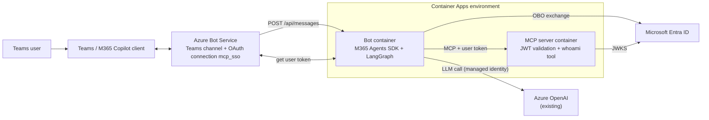
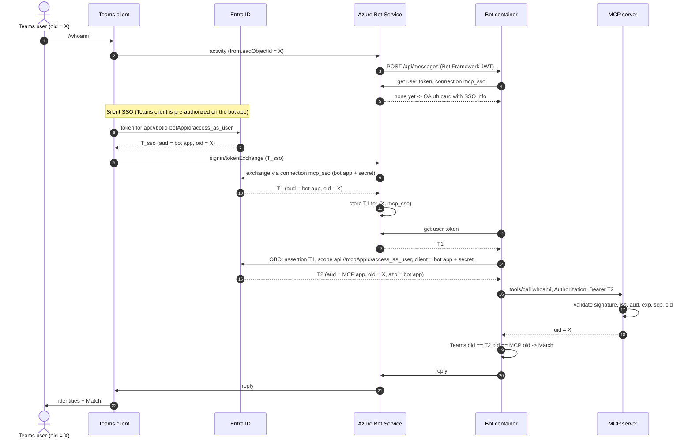

# Architecture

**Goal:** prove that the identity a **backend (MCP server)** authenticates is the **user who is chatting in Teams**,
using Azure Bot Service SSO and an On-Behalf-Of (OBO) exchange, with a LangGraph agent in between. The only Azure AI
dependency is an existing Azure OpenAI chat deployment; no Foundry features are used.

Contents: [1. Overview](#1-overview) | [2. Entra app registrations](#2-entra-app-registrations) |
[3. Azure Bot Service](#3-azure-bot-service) | [4. Teams app package](#4-teams-app-package) |
[5. The bot container](#5-the-bot-container-what-it-does-for-obo) | [6. The MCP server](#6-the-mcp-server) |
[7. Azure resources](#7-azure-resources) | [8. Flow diagrams](#8-flow-diagrams) | [9. Tokens](#9-tokens)

## 1. Overview

How the proof works:

1. Teams signs the user in silently (SSO) and gets a token for the **bot's own API**. Azure Bot Service exchanges it
   through the `mcp_sso` OAuth connection and stores it per user.
2. The bot container asks Bot Service for that user token and swaps it for a token for the **MCP API** with an
   **OBO exchange** (the bot app is the confidential client).
3. The bot calls the MCP server with the new token. The MCP server validates it and `whoami` returns the `oid` from
   the validated claims.
4. `/whoami` compares the Teams `aadObjectId`, the `oid` in the token and the `oid` the MCP server saw. The LLM never
   sees any user token.

Two identities are kept apart on purpose:

| Path | Identity | Used for |
|---|---|---|
| **User path** | Entra app `obo-demo-bot-*` (+ secret), Entra app `obo-demo-mcp-*` | Azure Bot identity, OAuth connection, OBO client, token audience |
| **Workload path** | System-assigned managed identities of the Container Apps | ACR pull (both apps); Azure OpenAI access (bot app only) |

## 2. Entra app registrations

Created idempotently by `infra/hooks/preprovision.ps1` (both single tenant, v2 tokens). The Azure Bot needs the bot app
to exist before provisioning, which is why the hook runs first.

### Bot app: `obo-demo-bot-<env>`

The bot app plays four roles: Azure Bot identity, client of the Bot Service OAuth connection, confidential client for the
OBO exchange, and itself an **API** that Teams SSO targets.

| Setting | Value | Why |
|---|---|---|
| Application (client) ID | `<botAppId>` | Azure Bot `msaAppId`, manifest `bots[].botId`, SDK `CLIENTID` |
| Application ID URI | `api://botid-<botAppId>` | The format Teams requires for **bot** SSO. Must equal the connection's Token Exchange URL and the manifest `webApplicationInfo.resource` (see [3](#3-azure-bot-service)) |
| Exposed scope | `access_as_user` (user consent) | The scope Teams requests and Bot Service exchanges |
| `requestedAccessTokenVersion` | `2` | v2 tokens, as the MCP server expects |
| Pre-authorized clients (on `access_as_user`) | Teams desktop/mobile `1fec8e78-...`, Teams web `5e3ce6c0-...`, M365 web `4765445b-...`, M365 desktop `0ec893e0-...`, M365 mobile / Office desktop `d3590ed6-...`, Outlook web `bc59ab01-...`, Outlook mobile `27922004-...` | Lets those Microsoft clients obtain the SSO token **without a consent prompt** |
| Web redirect URIs | `https://token.botframework.com/.auth/web/redirect`, `https://token.botframework.com/.auth/callback` | Needed by the interactive sign-in fallback |
| API permission | Delegated `access_as_user` on the MCP app, admin-consented | The OBO exchange can request the MCP scope |
| Client secret | 1 year, stored in the azd env and the bot Container App secret | OAuth connection and OBO exchange (a federated credential would be the production upgrade) |

### MCP app: `obo-demo-mcp-<env>`

A pure API. It has no secret and calls nothing.

| Setting | Value | Why |
|---|---|---|
| Application ID URI | `api://<mcpAppId>` | Audience of the OBO token |
| Exposed scope | `access_as_user` | The MCP server requires it in `scp` |
| `requestedAccessTokenVersion` | `2` | v2 tokens |
| Pre-authorized client | the **bot app** | OBO succeeds without user consent |

## 3. Azure Bot Service

Defined in `infra/resources.bicep`.

| Resource | Configuration | Why |
|---|---|---|
| Azure Bot (`bot-<token>`, F0) | `msaAppType: SingleTenant`, `msaAppId` = bot app, `msaAppTenantId` = tenant, endpoint `https://<bot-fqdn>/api/messages`, display name `OBO Demo (<env>)` | Channel registration. Uses the bot app, which doubles as the OBO confidential client |
| Channel `MsTeamsChannel` | enabled | Teams (and Copilot, which uses the Teams channel) |
| OAuth connection `mcp_sso` | Provider **Azure Active Directory v2** (`serviceProviderId 30dd229c-...`); `ClientId` = bot app, `ClientSecret` = bot secret, `TenantId`, **`TokenExchangeUrl = api://botid-<botAppId>`**, `scopes = api://botid-<botAppId>/access_as_user` | Bot Service swaps the Teams SSO token for a user token for the bot API (T1) and stores it per user and connection |

**The identifier URI must match in three places**, otherwise Teams silent SSO fails with `resourcematchfailed`:

| Where | Setting |
|---|---|
| Entra bot app | Application ID URI |
| Azure Bot OAuth connection | `TokenExchangeUrl` (and the scope prefix) |
| Teams manifest | `webApplicationInfo.resource` |

## 4. Teams app package

`scripts/make_teams_package.py` writes `dist/teams-app.zip` (run by `postprovision`).

| Manifest field | Value | Purpose |
|---|---|---|
| `manifestVersion` | `1.22` | Required for `copilotAgents` |
| `id` | bot app id (override: `TEAMS_MANIFEST_ID`) | Teams app identity |
| `bots[].botId` | bot app id | Binds the app to the Azure Bot |
| `bots[].scopes` | `personal`, `groupChat` | 1:1 and group chats. Bot SSO is not supported in channels, so `team` is omitted |
| `webApplicationInfo` | `id` = bot app id, `resource` = `api://botid-<botAppId>` | Turns on SSO |
| `copilotAgents.customEngineAgents` | `{ type: bot, id: <botAppId> }` | Exposes the bot as an agent in Microsoft 365 Copilot (requires the `personal` scope) |
| `validDomains` | bot FQDN, `token.botframework.com` | Allows the sign-in redirect |
| `commandLists[].description` | `/whoami`, `/signout` | Teams inserts the **description** into the compose box when a prompt is clicked, so it is the literal command |

The app name shown in Teams is `OBO Demo (<azd env name>)`.

## 5. The bot container: what it does for OBO

Code: `bot/src/bot/app.py` (Agents SDK host), `bot/src/bot/agent.py` (LangGraph). Public ingress on port 3978.

**Configuration (Container App environment variables, set in Bicep)**

| Variable | Purpose |
|---|---|
| `CONNECTIONS__SERVICE_CONNECTION__SETTINGS__CLIENTID` / `CLIENTSECRET` / `TENANTID` | The bot app credentials. Used to authenticate to Bot Service and as the **confidential client of the OBO exchange**. The secret comes from a Container App secret |
| `CONNECTIONSMAP__0__SERVICEURL=*`, `CONNECTIONSMAP__0__CONNECTION=SERVICE_CONNECTION` | Use that connection for all channels |
| `AGENTAPPLICATION__USERAUTHORIZATION__HANDLERS__MCP__SETTINGS__AZUREBOTOAUTHCONNECTIONNAME=mcp_sso` | The user-authorization handler `MCP` reads user tokens from the Azure Bot OAuth connection `mcp_sso` |
| `AGENTAPPLICATION__USERAUTHORIZATION__HANDLERS__MCP__SETTINGS__OBOCONNECTIONNAME=SERVICE_CONNECTION` | The handler performs OBO with this connection |
| `MCP_SCOPE=api://<mcpAppId>/access_as_user`, `MCP_URL=https://<mcp-fqdn>/mcp` | OBO target scope and backend URL |
| `AZURE_OPENAI_ENDPOINT`, `AZURE_OPENAI_DEPLOYMENT` | The LLM. Authenticated with the container's managed identity (`DefaultAzureCredential`); `AZURE_OPENAI_API_KEY` is accepted for local runs |
| `TEAMS_SILENT_SSO` | `true` (default). `false` strips `tokenExchangeResource` from sign-in cards so Teams shows a plain **Sign in** button |

**Per-turn behaviour**

1. **Authenticate the inbound request.** `jwt_authorization_middleware` validates the Bot Framework token (audience =
   bot app). Only `/healthz` is exempt.
2. **Get the user token.** Routes declared with `auth_handlers=["MCP"]` run the SDK's sign-in flow first. It asks Bot
   Service for the user's token on `mcp_sso`. If none exists, it sends an OAuth card; Teams answers with a
   `signin/tokenExchange` invoke (silent SSO) or `signin/verifyState` (interactive), Bot Service stores the token, and the
   SDK replays the original message.
3. **OBO exchange.** `AGENT_APP.auth.exchange_token(context, [MCP_SCOPE], "MCP")` calls MSAL
   `acquire_token_on_behalf_of` with T1 as the assertion and the bot app secret, returning T2 (audience = MCP app, same
   `oid`). T2 is held in memory for the turn only.
4. **Call the backend.** T2 goes in the `Authorization: Bearer` header of the MCP request (`langchain-mcp-adapters` for the
   agent, a plain MCP client for `/whoami`). The LangGraph agent decides *whether* to call the `whoami` tool; the LLM never
   sees the token.
5. **Report.** Compare `from.aadObjectId` (Teams) with the `oid` in T2 and in the MCP response.

**Resilience details** (all in `app.py`)

| Behaviour | Why |
|---|---|
| Up to 4 retries (1.5 s apart) when the user token is not yet available | Right after silent SSO, Bot Service can briefly answer 404 before the token is retrievable |
| `signin/failure` invokes are acknowledged with HTTP 200 | The SDK would answer 501, which stops Teams from showing the interactive **Sign in** button |
| Sign-in state is cleared on `installationUpdate` | A pending flow left in memory from an earlier install would treat the next messages as magic codes |
| Diagnostics log the `azp`/`aud`/`scp` claims, chat type and result of each `tokenExchange` | Makes silent-SSO problems visible (never the token itself) |

Sign-in state lives in `MemoryStorage`, so run **one replica** (the demo does) or move to shared storage.

## 6. The MCP server

Code: `mcp_server/src/mcp_server/`. Public ingress on port 8000, protected by JWT validation only.

For every request except `/healthz` it validates the bearer token (PyJWT, signing keys from the tenant JWKS endpoint):

| Check | Value |
|---|---|
| Signature | RS256, key from `https://login.microsoftonline.com/<tenant>/discovery/v2.0/keys` |
| Issuer | `https://login.microsoftonline.com/<tenant>/v2.0` |
| Audience | `<mcpAppId>` or `api://<mcpAppId>` |
| Scope | `access_as_user` in `scp` |
| Subject | `oid` claim present (a user token, not an app token) |

The `whoami` tool returns `oid`, `name`, `preferred_username` and `tid` from the **validated** claims and logs
`whoami called by oid=...`. Missing or invalid tokens get 401.

## 7. Azure resources

Created by `infra/*.bicep` at subscription scope.

| Resource | Name | Intent |
|---|---|---|
| Resource group | `rg-<env>` | Container for everything |
| Log Analytics workspace | `log-<token>` | Container App logs (shows the `oid` the MCP server saw) |
| Container Registry (Basic) | `cr<token>` | Holds the two images, built remotely by `azd deploy` |
| Container Apps environment | `cae-<token>` | Shared host |
| Container App: MCP server | `ca-mcp-<token>` | The backend where the user identity is **proven**. System-assigned identity with AcrPull only |
| Container App: bot | `ca-bot-<token>` | Agents SDK host + LangGraph agent + OBO. System-assigned identity with AcrPull and *Cognitive Services OpenAI User* on your OpenAI account |
| Azure Bot, Teams channel, OAuth connection `mcp_sso` | `bot-<token>` | See [3](#3-azure-bot-service) |
| Existing Azure OpenAI deployment | *(yours)* | The agent's LLM; the only AI service used |

Both Container Apps are created with a placeholder image, given the identity, granted AcrPull, and then switched to
the registry; `azd deploy` replaces the placeholder with the built images. External ingress FQDNs are deterministic, so
the Azure Bot endpoint can be set without a circular dependency.

## 8. Flow diagrams

For free-text messages the same token is used, but the LangGraph agent decides to call `whoami` via the LLM (which is
reached with the managed identity and never sees the user token).

## 9. Tokens

| # | Token | Issued for (audience) | Requested by (client) | User inside | Held by | Purpose |
|---|---|---|---|---|---|---|
| T0 | Bot Framework JWT | Bot app | Bot Framework | none | Bot (validates) | Authenticates inbound activities |
| T_sso | Teams SSO token | `api://botid-<botAppId>` | Teams client | X | Teams, then Bot Service | Proves X is signed in |
| T1 | Bot-API user token | Bot app, `access_as_user` | Bot Service (bot app + secret) | X | Bot Service store, handed to the bot | **OBO assertion**; never sent to the MCP server |
| T2 | MCP user token | MCP app, `access_as_user` | Bot container (OBO, bot app + secret) | X (same `oid`), `azp` = bot app | Bot memory, per turn | **What the MCP server validates** |
| T3 | Managed identity token | Azure OpenAI | Bot container identity | none | Bot | LLM access only |
| T4 | Bot outbound token | Bot Framework | Bot app (client credentials) | none | Bot | Sending replies, calling the User Token API |

The chain: T_sso proves X is signed in; Bot Service turns it into T1 (still for the bot API); the bot turns T1 into T2
(audience changes to the MCP app, **the user does not**). The proof is that the same `oid` appears in the Teams activity,
in T1/T2 and in the MCP server's response and log line, and that the MCP server only ever accepts a token issued for
that user. T0, T3 and T4 carry no user, so they cannot be confused with the user path.
