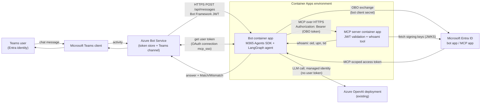

# Architecture

Goal: prove that the identity the **backend (MCP server)** authenticates is the **user who is chatting in Teams**,
using Azure Bot Service OAuth/SSO and an On-Behalf-Of (OBO) exchange, with a LangGraph agent in between and no
Foundry features (only an LLM endpoint).

## 1. Entra ID app registrations (created by `infra/hooks/preprovision.ps1`)

| App registration | Role in the demo |
|---|---|
| `obo-demo-bot-<env>` (single tenant) | **Bot identity and OBO client.** It is (a) the Azure Bot's `msaAppId`, (b) the client of the Bot Service OAuth connection, (c) the confidential client the Agents SDK uses for the OBO exchange, and (d) a **resource/API** itself: it exposes `access_as_user` so Teams SSO can obtain a token for it. Redirect URI `https://token.botframework.com/.auth/callback`. Teams desktop/mobile and web client IDs are pre-authorized on its scope. App ID URI is `api://<bot-fqdn>/<bot-app-id>` (set in `postprovision`). Has a client secret (azd env + Container App secret) and is configured to call the MCP API (`requiredResourceAccess`). |
| `obo-demo-mcp-<env>` (single tenant) | **The protected backend API.** Exposes `api://<mcp-app-id>/access_as_user` with `requestedAccessTokenVersion = 2`. The bot app is pre-authorized, so no user consent prompt is needed. The MCP server accepts only tokens whose audience is this app. No secret; it calls nothing. |

A service principal is created for each in your tenant. No Entra app exists for the LLM; the bot app reaches it with its system-assigned managed identity.

**Identities are kept separate by purpose:**

| Identity | Type | Used for |
|---|---|---|
| Bot Entra app (`obo-demo-bot-*`) | App registration + secret | Azure Bot identity, OAuth connection, OBO client (the *user* path) |
| MCP Entra app (`obo-demo-mcp-*`) | App registration | Audience of the OBO token (the *backend API*) |
| Bot Container App identity | System-assigned MI | ACR pull + LLM access (the *workload* path) |
| MCP Container App identity | System-assigned MI | ACR pull only |

The Azure Bot resource uses the Entra app (`msaAppType: SingleTenant`); Bot Service does not support
system-assigned identities, and OBO requires the confidential-client app anyway.

## 2. Azure resources (created by `infra/*.bicep`, subscription scope)

| Resource | Name pattern | Intent | How it maps to the goal |
|---|---|---|---|
| Resource group | `rg-<env>` | Container for everything | Housekeeping |
| Log Analytics workspace | `log-<token>` | Container App logs | Lets you show in logs which `oid` the MCP server saw |
| Container Registry (Basic) | `cr<token>` | Stores the two images | Built remotely by `azd deploy` |
| System-assigned managed identity (MCP app) | *(on `ca-mcp-<token>`)* | AcrPull on the registry only | Image pull only; no LLM access, no other roles |
| System-assigned managed identity (bot app) | *(on `ca-bot-<token>`)* | AcrPull on the registry; Cognitive Services OpenAI User on your existing OpenAI account | LLM access with no secrets and no Foundry feature; deliberately *not* involved in the user proof |
| Container Apps environment | `cae-<token>` | Shared host for both apps | Hosting |
| Container App: MCP server | `ca-mcp-<token>` (public ingress, 8000) | **The "backend service"**: validates the JWT (Entra JWKS signature, issuer, audience, `access_as_user`, `oid`) and exposes the `whoami` tool | Where the user identity is *proven* |
| Container App: bot | `ca-bot-<token>` (public ingress, 3978) | Agents SDK host + LangGraph agent; performs the OBO exchange; calls the MCP server with the user's token | The "Teams bot running a LangGraph agent" |
| Azure Bot (F0, SingleTenant) | `bot-<token>` | Channel registration; messaging endpoint `https://<bot-fqdn>/api/messages` | Routes Teams traffic to the bot and holds the user's token |
| Teams channel | `MsTeamsChannel` | Enables Teams | Teams is the user surface |
| Bot OAuth connection | `mcp_sso` (Entra ID v2) | Teams SSO yields a token for the bot API; Bot Service stores it per user | Where the Teams user's identity becomes an access token |
| Role assignments | AcrPull on the ACR; Cognitive Services OpenAI User on your existing OpenAI account | Least privilege | Supports the above |
| Existing Azure OpenAI deployment | *(you provide it)* | The agent's LLM | Only LLM access is used |

`dist/teams-app.zip` is a build artifact, not an Azure resource. Its manifest has `webApplicationInfo`
(bot app ID + `api://<bot-fqdn>/<bot-app-id>`), which enables SSO.

## 3. Component flow



## 4. Request path and token exchange

```mermaid
sequenceDiagram
    autonumber
    actor U as Teams user
    participant T as Teams client
    participant E as Entra ID
    participant B as Azure Bot Service<br/>(+ token store)
    participant A as Bot app (Agents SDK + LangGraph)
    participant M as MCP server
    participant L as Azure OpenAI

    Note over U,T: Already signed in to Teams as user X (Entra oid = X)
    U->>T: "/whoami"
    T->>B: Activity (from.aadObjectId = X)
    B->>A: POST /api/messages<br/>Bearer T0 (Bot Framework JWT, aud = bot app id)
    A->>A: Validate T0 (JWT middleware)
    A->>B: Get user token for connection "mcp_sso"<br/>(auth: bot outbound token T4)
    B-->>A: No token yet -> OAuth card with SSO info

    Note over T,E: Teams SSO (silent; Teams clients are pre-authorized)
    T->>E: Acquire token for api://bot-fqdn/botAppId/access_as_user
    E-->>T: T_sso (aud = bot app, scp = access_as_user, oid = X)
    T->>B: signin/tokenExchange invoke with T_sso
    B->>E: Exchange T_sso (connection mcp_sso: bot app id + secret, TokenExchangeUrl)
    E-->>B: T1 (aud = bot app, scp = access_as_user, oid = X)
    B->>B: Store T1 for (user X, connection mcp_sso)

    A->>B: Get user token "mcp_sso"
    B-->>A: T1
    A->>E: OBO: assertion = T1, scope = api://mcp-app-id/access_as_user<br/>client = bot app + secret
    E-->>A: T2 (aud = MCP app, scp = access_as_user, oid = X, azp = bot app id)

    A->>M: MCP tools/call whoami<br/>Authorization: Bearer T2
    M->>E: GET JWKS (cached)
    M->>M: Validate sig, iss, aud, exp, scp = access_as_user, oid present
    M-->>A: {oid: X, preferred_username, tid}
    A->>A: Compare Teams aadObjectId (X) with oid in T2 and MCP response (X) -> Match
    opt Free-form question (LangGraph path)
        A->>L: Chat completion, tools = [whoami]<br/>Bearer = managed identity token T3 (no user identity)
        L-->>A: Tool call whoami
        A->>M: whoami with Bearer T2 (header added per turn; the LLM never sees T2)
        M-->>A: claims
        A->>L: Tool result
        L-->>A: Final answer
    end
    A->>B: Reply activity (bot outbound token T4)
    B->>T: Reply
    T->>U: Teams identity, backend identity, Match
```

### Tokens at a glance

| # | Token | Issuer -> audience | Subject | Held by | Purpose |
|---|---|---|---|---|---|
| T0 | Bot Framework JWT | Bot Framework -> bot app id | channel service | Bot app (validates) | Authenticates inbound activities |
| T_sso | Teams SSO token | Entra -> `api://<bot-fqdn>/<bot-app-id>` | user X | Teams client -> Bot Service | Proves X is signed in; input to the exchange |
| T1 | Bot-API user token | Entra -> bot app (`access_as_user`) | user X | Bot Service token store, handed to the bot | **The OBO assertion**; never sent to the MCP server |
| T2 | MCP user token | Entra -> MCP app (`access_as_user`) | user X (same `oid`), `azp` = bot | Bot app, in memory per turn | Bearer to the backend; **what the MCP server validates** |
| T3 | Managed identity token | Entra -> Azure OpenAI | the managed identity | Bot app | LLM access only; no user identity |
| T4 | Bot outbound token | Entra -> Bot Framework | the bot app | Bot app | Replies and User Token API calls |

The proof: the same `oid` appears in the Teams activity (`aadObjectId`), in T1 and T2, and in the MCP server's
`whoami` response (and its log line), and the MCP server never receives anything other than a token issued for that user.

## 5. Caveat

The agent <-> MCP path is tested, but Teams SSO + the Bot Service connection + the live Entra exchange have **not**
been run end to end. Likely first-deploy adjustments: the Bot connection parameter casing / `scopes` value, and
tenant app-management policy for the `api://<fqdn>/<appId>` identifier URI.
